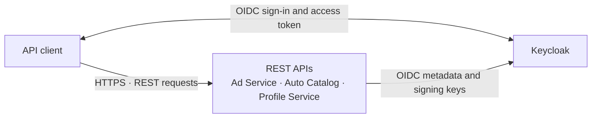
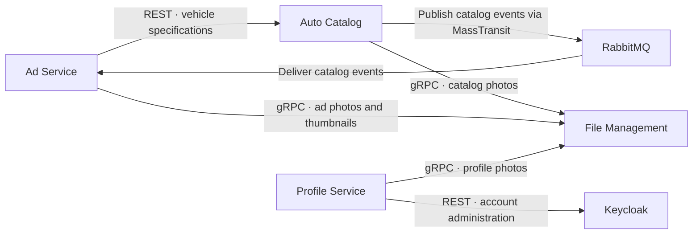
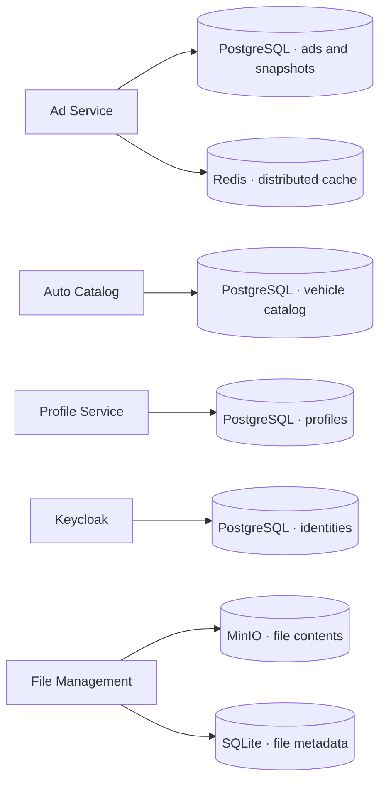
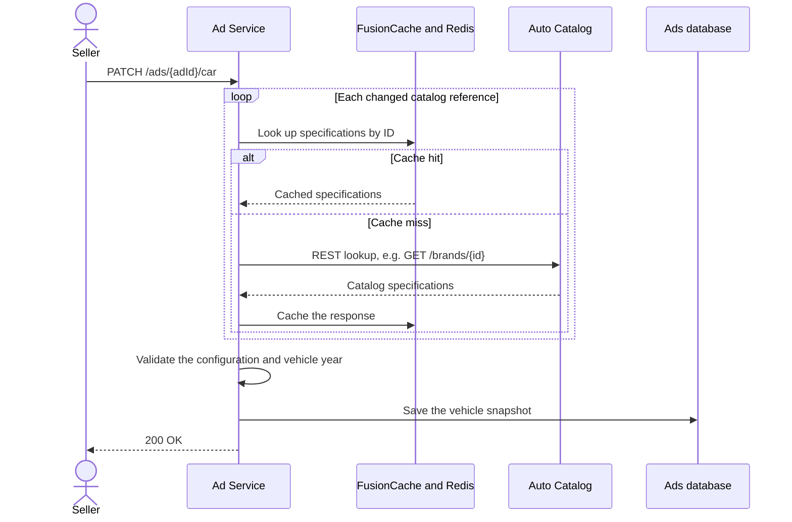
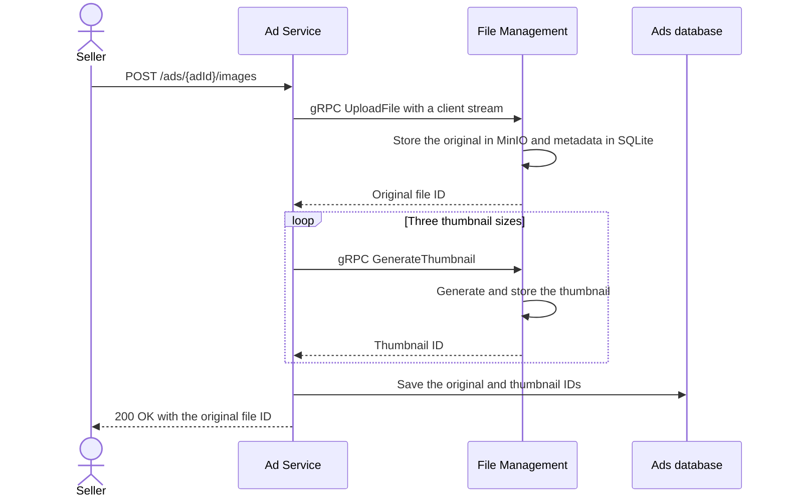
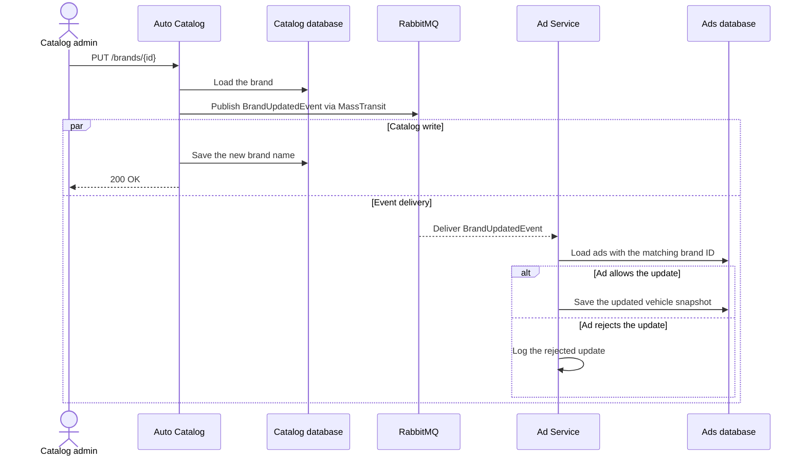

# CarSale

CarSale is a microservices platform for selling cars. Sellers create ads, select vehicle specifications from a shared catalog, upload photos, and submit their ads for moderation. Buyers can browse ads once they are published.

The backend is written in C# on .NET 9. The project explores service-to-service communication over REST, gRPC, and RabbitMQ. It is inspired by [av.by](https://av.by) and [drom.ru](https://drom.ru).

## Contents

- [Microservices](#microservices)
- [Architecture](#architecture)
- [Example: publishing a Volkswagen Passat ad](#example-publishing-a-volkswagen-passat-ad)
- [Service communication](#service-communication)
- [How to run](#how-to-run)
- [Roadmap](#roadmap)

## Microservices

| Service             | Responsibility                                                                                                            | Stack                                                                   |
| ------------------- | ------------------------------------------------------------------------------------------------------------------------- | ----------------------------------------------------------------------- |
| **Ad Service**      | Manages ads, moderation, filtering, and pagination. Stores vehicle and seller snapshots with each ad.                     | ASP.NET Core REST API, PostgreSQL, EF Core, MediatR, FusionCache, Redis |
| **Auto Catalog**    | Manages brands, models, generations, engines, and vehicle configurations. Publishes events for supported catalog updates. | ASP.NET Core REST API, PostgreSQL, EF Core, MediatR, MassTransit        |
| **File Management** | Streams file uploads, generates thumbnails, and issues temporary download links.                                          | ASP.NET Core gRPC, MinIO, SQLite, ImageSharp                            |
| **Profile Service** | Manages user profiles and profile photos. Exposes profile details and ad snapshots.                                       | ASP.NET Core REST API, PostgreSQL, EF Core, Keycloak, gRPC client       |

Ad Service uses Clean Architecture, DDD, and CQRS. Auto Catalog organizes its endpoints and CQRS handlers into vertical slices. GitHub Actions builds Ad Service and Auto Catalog and runs the Ad Service xUnit tests. [CI workflow](.github/workflows/dotnet.yml)

## Architecture

### API access and identity

The client obtains an access token from Keycloak and sends it to protected REST endpoints. A buyer can read a published ad without signing in.



### Communication between services

Ad Service fetches vehicle specifications from Auto Catalog over REST. Catalog updates travel back to Ad Service as events through RabbitMQ. Each service uses File Management over gRPC for its own photos.



The seller snapshot currently comes from an in-process stub in Ad Service. Profile Service exposes its own REST API for profile operations. [Seller profile stub](src/Services/AdService/AdService.Infrastructure.ProfileService/ProfileServiceClient.cs) · [Profile API endpoints](src/Services/ProfileService/ProfileService.Presenters/Endpoints)

### Data ownership

Ad Service, Auto Catalog, Profile Service, and Keycloak each have a PostgreSQL database. Ad Service also uses Redis as a distributed cache. File Management stores file contents in MinIO and file metadata in SQLite.



## Example: publishing a Volkswagen Passat ad

| Step                | Request                                        | Result                                                                                                                          |
| ------------------- | ---------------------------------------------- | ------------------------------------------------------------------------------------------------------------------------------- |
| Create a draft      | `POST /ads`                                    | Ad Service uses the seller ID from the JWT to create or return a draft.                                                         |
| Select the vehicle  | `PATCH /ads/{adId}/car`                        | Ad Service checks the selected specifications and stores a vehicle snapshot.                                                    |
| Add ad details      | `PATCH /ads/{adId}`                            | The seller sets a title, price, city, and region.                                                                               |
| Upload a photo      | `POST /ads/{adId}/images`                      | The seller sends `multipart/form-data` with a `file` field. File Management stores the original and generates three thumbnails. |
| Submit for review   | `POST /ads/{adId}/submit`                      | The seller moves the ad from `DRAFT` to `PENDING` after filling in the required fields and adding a photo.                      |
| Approve and publish | `POST /ads/{adId}/publish`                     | A moderator moves the ad to `PUBLISHED`.                                                                                        |
| View the ad         | `GET /ads/{adId}` and `GET /ads/{adId}/images` | A buyer can read the ad and retrieve its photos.                                                                                |

Send the following request to Ad Service over HTTPS with a draft ID and the seller's access token. It selects the seeded Volkswagen Passat B5 restyling configuration and sets the year to 2004. [Seeded vehicles](src/Services/AutoCatalog/AutoCatalog.Infrastructure/Seeding/InitialData/Cars.cs) · [Seeded generations](src/Services/AutoCatalog/AutoCatalog.Infrastructure/Seeding/InitialData/Generations.cs)

```http
PATCH /ads/{adId}/car HTTP/1.1
Host: localhost:6062
Authorization: Bearer <access_token>
Content-Type: application/merge-patch+json

{
  "brandId": 1,
  "modelId": 2,
  "generationId": 2,
  "engineId": 2,
  "driveTypeId": 3,
  "transmissionTypeId": 1,
  "bodyTypeId": 1,
  "year": 2004
}
```

## Service communication

### Setting vehicle details over REST

Ad Service retrieves changed catalog references through a typed `HttpClient` when they are missing from the cache. It validates the selected specifications and saves a vehicle snapshot with the ad. [Catalog client](src/Services/AdService/AdService.Infrastructure.AutoCatalog/AutoCatalogClient.cs) · [Vehicle update handler](src/Services/AdService/AdService.Application/Commands/MergePatchAdsCar/MergePatchAdsCarHandler.cs)



### Uploading ad photos over gRPC

The seller sends a photo to Ad Service over REST. Ad Service streams it to File Management, requests three thumbnail sizes, and saves the returned IDs with the ad. [Photo upload handler](src/Services/AdService/AdService.Application/Commands/UploadImage/UploadImageHandler.cs)



Profile Service also calls File Management over gRPC to upload profile photos and request temporary download links. [Profile photo upload](src/Services/ProfileService/ProfileService.Application/Commands/UpdateMyProfilePicture/UpdateMyProfilePictureCommandHandler.cs) · [Profile lookup](src/Services/ProfileService/ProfileService.Application/Queries/GetMyProfile/GetMyProfileQueryHandler.cs)

### Propagating catalog updates through RabbitMQ

When an administrator renames a brand, Auto Catalog publishes `BrandUpdatedEvent`. Ad Service finds ads with the matching brand ID and attempts to update their vehicle snapshots. Drafts can accept the change. Published ads reject brand changes under the current domain rules, and the consumer logs those rejections. [Event publisher](src/Services/AutoCatalog/AutoCatalog.Application/Brands/UpdateBrand/UpdateBrandHandler.cs) · [Event consumer](src/Services/AdService/AdService.Infrastructure.MessageBus/EventHandlers/BrandUpdatedEventHandler.cs) · [Ad domain rules](src/Services/AdService/AdService.Domain/Aggregates/Ad.cs)



## How to run

Docker Compose defines the development stack. The development override mounts local ASP.NET Core user secrets and an HTTPS certificate into the .NET containers. [Compose services](docker-compose.yml) · [Development override](docker-compose.override.yml)

1. Create a `.env` file in the repository root. Run `docker compose config --variables` to see the variables used by Compose.
2. Set the PostgreSQL database names, users, and passwords. Set `AUTOCATALOG_POSTGRES_SERVER`, `ADSERVICE_POSTGRES_SERVER`, `PROFILESERVICE_POSTGRES_SERVER`, and `KEYCLOAK_POSTGRES_SERVER` to `autocatalogdb`, `adservicedb`, `profileservicedb`, and `keycloakdb` respectively.
3. Set `RABBITMQ_DEFAULT_USER` and `RABBITMQ_DEFAULT_PASS`. Configure the same values as `RabbitMQ:Username` and `RabbitMQ:Password` for Ad Service and Auto Catalog. Set `KEYCLOAK_ADMIN_SECRET` to the secret for the `profile-service` client in Keycloak. Set `Minio:AccessKey` and `Minio:SecretKey` for File Management to match the MinIO instance.
4. Place `aspnetapp.pfx` under `${USERPROFILE}/.aspnet/https/` and set `Kestrel:Certificates:Default:Password` for the .NET services. The Compose override mounts user secrets from `${APPDATA}/Microsoft/UserSecrets/`.
5. Validate the configuration and start the stack.

    ```bash
    docker compose config --quiet
    docker compose up --build
    ```

| Service                    | Local address                 |
| -------------------------- | ----------------------------- |
| Ad Service Swagger UI      | `https://localhost:6062/docs` |
| Auto Catalog Swagger UI    | `https://localhost:6060/docs` |
| Profile Service Swagger UI | `https://localhost:6063/docs` |
| File Management gRPC       | `https://localhost:6061`      |
| Keycloak                   | `http://localhost:8080`       |
| RabbitMQ management        | `http://localhost:15672`      |
| MinIO console              | `http://localhost:9001`       |

## Roadmap

- Connect Ad Service to Profile Service for seller data.
- Add YARP as a reverse proxy.
- Build a web UI for browsing, creating, and moderating ads.
